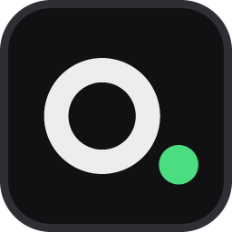

# 7q9k route

Local server that exposes OpenCode Zen's free models as an OpenAI-, Anthropic- and Ollama-compatible API, with a web dashboard. Python standard library only. Personal use. Formerly `oc-free-api`.

## Download

From [Releases](https://github.com/7q9k/7q9k-route/releases):

- `7q9k-route-<version>.exe`: Windows, no Python needed. Double-click it. Your key, stats and settings are stored in `%LOCALAPPDATA%\7q9k-route`, not next to the exe.
- `7q9k-route-<version>-python.zip`: any OS with Python 3.10+. Unzip and run `python server.py`.

Upgrading from oc-free-api: the first start moves your key, stats, settings and app backups from `%LOCALAPPDATA%\oc-free-api`, keeps "start with Windows" on, and replaces the old entries in connected apps.

## Run

Double-click `7q9k-route.exe`. A small window shows the dashboard address, the browser opens, and the server keeps running in the background. Opening the exe again just opens the dashboard.

Everything else happens in the dashboard (http://localhost:8787): who can connect, port, start with Windows, API key, restart and stop.

Base URL for apps: `http://localhost:8787/v1` (also works without `/v1`). The API key is shown in the dashboard and stored in `api-key.txt` in the data folder.

Command line options (optional): `--port`, `--host`, `--key`, `--no-browser`, `--background`, `--no-save`.

## Apps

The Apps tab finds supported apps on this computer and adds 7q9k route to them with one click: Claude Code, DeepSeek Harness and Hermes. A backup of each changed file is kept, and connected apps are updated automatically when the key, port or model list changes. New apps are added as a small class in `integrations.py`.

Under Settings you can set your own fixed API key; it stays the same across restarts and updates.

## Claude Code

Apps -> Claude Code -> Connect writes the route into the `env` block of `~/.claude/settings.json` (or `%CLAUDE_CONFIG_DIR%`): `ANTHROPIC_BASE_URL`, `ANTHROPIC_AUTH_TOKEN` and the model settings (`ANTHROPIC_MODEL`, the opus/sonnet/haiku defaults and the subagent model), all set to the default model. Start a new `claude` session and switch models with `/model <name>`, e.g. `/model big-pickle`. Requests for Claude model names (`claude-...`, `opus`, `sonnet`, `haiku`) go to the default model.

This applies to every Claude Code session on the computer, including the desktop app. Disconnect removes exactly these entries again and Claude Code goes back to your Anthropic login.

Not available through the route: Anthropic's server tools (web search, web fetch on Anthropic's side) and prompt caching. Token counts in Claude Code are estimates.

## Access

- Same computer: no key needed.
- Your network: the API key is always required.
- Settings, key reset and stop only work on the computer that runs the server.

## API

| Endpoint | |
|---|---|
| `POST /v1/chat/completions` | OpenAI Chat Completions (stream, tools) |
| `POST /v1/responses` | OpenAI Responses API (stateless) |
| `POST /v1/messages`, `/v1/messages/count_tokens` | Anthropic Messages API (stream, tools), used by Claude Code |
| `GET /v1/models` | model list |
| `POST /api/chat`, `/api/generate`, `GET /api/tags` | Ollama-compatible |

## Dashboard

Charts for requests and tokens (30 min / 24 h), tokens and cost per model, response times, model tests, a chat playground and an activity log. Stats are saved to `stats.json` and survive restarts. Cost shows what the same tokens would cost on OpenRouter (live prices, exact model matches only).

## Errors from OpenCode

Free models sometimes answer HTTP 503 ("Endpoint is unavailable") for a few seconds. 7q9k route retries those up to four times (after 0.5, 1, 2 and 4 seconds) before anything is sent to the app, so the app only sees an error if the model stays down. Retries show up in the log.

## Free limit

OpenCode is not unlimited. Free models are rate-limited per IP; there is no official number (users report about 200 requests/day). When the limit is hit, OpenCode returns HTTP 429 `FreeUsageLimitError`. These are never retried.

## Tests

```
python -m unittest discover -s tests
```

## Notes

Based on [hermes-oc-free-provider](https://github.com/anpicasso/hermes-oc-free-provider). Follow the [OpenCode terms](https://opencode.ai/legal/terms-of-service): no reselling or sharing access. Free models may use your prompts for training, so do not send secrets.
